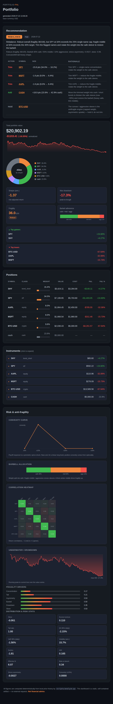

# aiSlang

**aiSlang is a declarative language and CLI for building multi-agent AI systems.** You describe the whole system — agents, capability-selected models with fallback and spend caps, prompts, MCP tools, RAG knowledge, evals, and how the agents compose — in one `.ais` file. The CLI type-checks it, resolves models against a bundled catalog, runs it locally, and emits the Docker Compose or Kubernetes stack (a LiteLLM router + Jaeger tracing + budget enforcement + your agents) that serves it.

> This repo is the **local + self-hosted `aislang` CLI**. It can also delegate operations to **aiSlang Cloud**, a managed control plane, via `aislang remote --target …`.

## Why aiSlang

Agent frameworks make it easy to demo *one* agent. Real systems compose many — a router picks a specialist, an orchestrator delegates, a reflector critiques and retries — and they need model fallback, spend caps, distributed tracing, scoped secrets, and a real way to serve the agents to users. Today you close that gap two ways: **imperative Python glue** (LangChain, LlamaIndex, CrewAI, AutoGen) — great libraries for agent *behavior*, but you hand-write and maintain the orchestration, there's no declarative description of the infrastructure, and turning a notebook into a deployed service is do-it-yourself; or **hand-rolled infrastructure** — Kubernetes/Compose manifests plus a LiteLLM router plus OpenTelemetry plus budget code, weeks of YAML that drifts the moment your agents change. aiSlang is not another agent framework and doesn't compete with those tools — it's the **declarative infrastructure layer beneath them** that turns a *described* multi-agent system into a running, observable, budget-enforced stack on your own machine or cluster.

→ Read [Why aiSlang](docs-site/src/why.md) for the full rationale.

## Demo — the `portfolio-pnl` agent

[**`examples/portfolio-pnl`**](examples/portfolio-pnl/) is the flagship example: a
local-first, multi-agent **portfolio analyst**. Deterministic Python skills fetch
prices and compute P&L, risk, and Taleb-style anti-fragility; a rule engine makes
a reproducible **keep / rebalance** decision; and two RAG-grounded agents
(**Strategic → Orchestrator**) explain it. The **Visualizer** skill renders this
self-contained dashboard — overview, positions, per-instrument prices, and a full
risk / anti-fragility panel:

[](examples/portfolio-pnl/sample-dashboard.html)

*(Open [`examples/portfolio-pnl/sample-dashboard.html`](examples/portfolio-pnl/sample-dashboard.html)
in a browser for the interactive version.)* Browse every example in the
[**agents catalog**](tools/catalog/agents-catalog.md).

## Quickstart

Install (detects OS + arch, verifies the SHA-256 checksum, installs the `aislang` binary to `~/.local/bin`):

```sh
curl -sSfL https://github.com/aiSlang/cli/releases/latest/download/install.sh | sh
```

The [full quickstart](docs-site/src/quickstart.md) walks through the flagship
[`portfolio-pnl`](examples/portfolio-pnl/) example end to end. With the repo
cloned, the core CLI loop against any `.ais` file is:

```sh
cd examples/portfolio-pnl
aislang validate portfolio.ais                    # parse + type-check + catalog-check (no network, no writes)
aislang skill run fetch_prices portfolio.ais      # deterministic skill: pull prices into the local SQLite DB
aislang skill run analyze      portfolio.ais      # deterministic skill: P&L / risk / anti-fragility + recommendation
aislang skill run visualize    portfolio.ais      # deterministic skill: render generated/dashboard.html
./run.sh                                          # full pipeline: fetch → analyze → dashboard → Strategic → Orchestrator
aislang chat advise portfolio.ais                 # chat the advisory pipeline directly
```

For the classic single-agent loop (`validate → plan → apply → chat → eval → destroy`),
the [quickstart](docs-site/src/quickstart.md) also links the minimal
[`support-agent.ais`](examples/support-agent.ais). Provider API keys come from a
local `.env` — aiSlang never reads real secrets, it only emits a safe-to-commit
`.env.example`. Docker is the only hard prerequisite; add `kubectl` / `helm` /
`kind` for the Kubernetes target.

→ [Install](docs-site/src/install.md) · [Quickstart](docs-site/src/quickstart.md) · [Deploying stacks](docs-site/src/deploy.md)

## Who it's for

aiSlang is for engineers who have moved past a single-agent demo and need to **run and operate a multi-agent system** without hand-building the plumbing:

- **AI / platform engineers** shipping multi-agent features who want model fallback, spend caps, tracing, and a reproducible deploy from one file.
- **Teams self-hosting on their own cluster** — emit a Helm chart, `helm install` it, and keep your own provider keys.
- **Local-first / privacy-conscious builders** — run the same file entirely against local models (Ollama), no external API required.
- **MCP host users** (Claude Desktop, Cursor) — expose the whole CLI as MCP tools and drive stacks straight from your assistant.

Typical use cases: a support agent grounded in a RAG knowledge base; an orchestrator chaining an architect → coder → reviewer pipeline; a router that dispatches requests by intent; graded evals wired into CI. See the [language guide](docs-site/src/language.md) and the runnable [`examples/`](examples/).

## Documentation

The full docs are the single source of truth — they live in **[`docs-site/`](docs-site/src/SUMMARY.md)** (an mdBook; run `mdbook serve docs-site` to read them locally):

| | | |
|---|---|---|
| [Introduction](docs-site/src/introduction.md) | [Why aiSlang](docs-site/src/why.md) | [Install](docs-site/src/install.md) |
| [Quickstart](docs-site/src/quickstart.md) | [The aiSlang language](docs-site/src/language.md) | [CLI reference](docs-site/src/cli-reference.md) |
| [Deploying stacks](docs-site/src/deploy.md) | [MCP integration](docs-site/src/mcp.md) | [Observability](docs-site/src/observability.md) |
| [Agents catalog](docs-site/src/agents.md) | | |

The language reference is [LANGUAGE-SPEC-v0.md](LANGUAGE-SPEC-v0.md); the architectural decisions behind the design are collected in [docs/ARCH-DECISIONS.md](docs/ARCH-DECISIONS.md).

## Next steps

- ⭐ **Star the repo** if you find it useful — it helps other people discover the project.
- 📖 **Read the full docs** in [`docs-site/`](docs-site/src/SUMMARY.md).

## Privacy Policy

The aiSlang MCP server runs on your machine, started by your MCP client. It reads and writes the `.ais` files and the local
Docker stacks you point it at, and talks to the LiteLLM proxy configured by `AISLANG_LITELLM_URL` (default
http://127.0.0.1:4000). It sends no telemetry, keeps no logs outside your project directory, and holds no provider
credentials — those live in your LiteLLM configuration. Prompts and tool arguments are forwarded only to the model 
endpoints your stack defines. 
Contact: support@aislang.org.


## License

Apache-2.0 — see [LICENSE](LICENSE).
